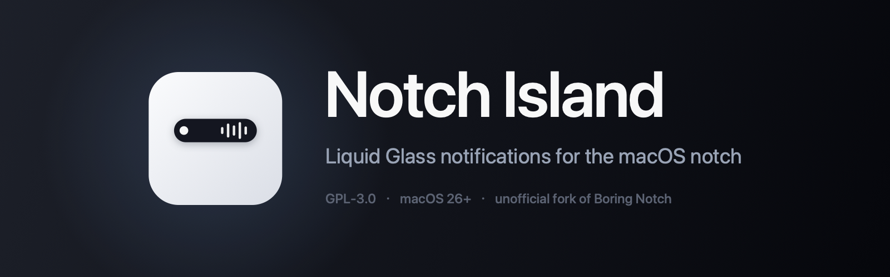
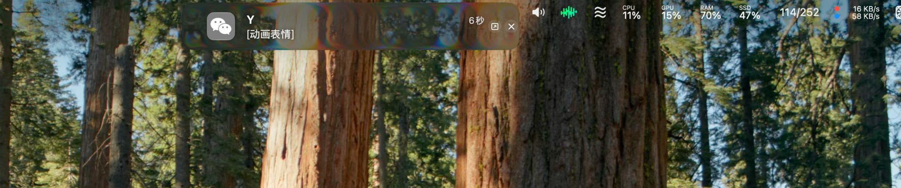
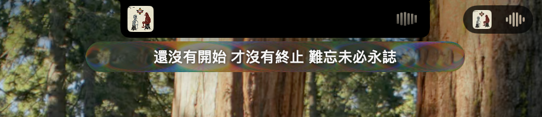

# Notch Island

[](https://github.com/7w4p4qg2xh-ai/notch-island/releases)
[](LICENSE)
[](#requirements)

<p align="center">
  
</p>

A fork of [Boring Notch](https://github.com/TheBoredTeam/boring.notch) that adds
an honest notification island, a Bluetooth battery indicator, a hand-built Liquid
Glass surface, and a floating island presentation for external displays.

> **This is an unofficial fork.** It is not affiliated with, endorsed by, or
> supported by The Bored Team. Please file issues here, not upstream. See
> [NOTICE](NOTICE) for the GPLv3 modification statement.

**Source only — no prebuilt binaries.** Signing a macOS app for distribution
requires a paid Apple Developer account and notarization. This repository ships
code, not releases. Build it yourself, it takes about five minutes.

---

## What it changes

Two display types, two separate code paths, selected per `screenUUID`. Changing
one never moves the other.

### Built-in notch display

- **Notifications are captured, not mirrored.** The system banner is parked
  off-screen and re-drawn under the camera cutout: auto-expand, a two-line card,
  app icons resolved through a multi-path fallback chain, click actions and
  replies mirrored back. The plate keeps the 520×132 proportions upstream tuned
  around the cutout.
- **A glass lyric strip.** While music plays, a 320×26 capsule hangs *below* the
  notch with the current line — the cutout itself has no pixels, so text cannot
  live inside it.
- **The collapsed plate stays pure black, on purpose.** Only pure black fuses
  with the camera housing; glass there reads as a sticker pasted over the notch.
- **Now-playing is left to upstream.** The built-in display keeps its original
  `MusicLiveActivity`; only the floating island gets the new card.

### Displays without a notch

- **The floating island.** Instead of a static black rectangle glued to the top
  edge: a 408×66 card that grows into a 480×150 panel, with `Capsule` corners
  that follow the plate height.
- **Glass even when collapsed** — the idle capsule is translucent, not black.
- **Adjustable geometry** — card width, panel size and corner radius are sliders
  under *Notch > Floating island*, with a reset button.
- **Suppresses itself when idle**, while full-screen notifications keep working.
- **Video sources don't raise a now-playing card.** The decision follows the
  playback source, not full-screen state, so a video app playing in a window is
  treated the same as one in full screen. Real music is unaffected.

### Both

- **Liquid Glass renderer.** `CABackdropLayer` → `CASDFLayer` →
  `CAFilter("glassBackground")`, edge lensing with a flat centre, following
  Apple's `NSGlassEffectView` measurements.
- **Backdrop-aware.** Samples the luminance actually behind the plate through
  ScreenCaptureKit, so a black window behind it produces edge-lit transparency
  rather than a grey slab.
- **Synchronized lyrics.** LRCLIB time-synced first, NetEase fallback, plain text
  last. Upstream tried AppleScript plain text first and returned early, which made
  the synced path unreachable.
- **Bluetooth peripheral battery** for headphones, mice and keyboards.

See [CHANGES.md](CHANGES.md) for the full breakdown including the parts that are
deliberately *not* copied from Apple.

---

## Screenshots

Both shots are from the built-in notch display.

Notification card — the system banner is gone, the island draws it instead:



Music card with the current lyric line advancing as the track plays:



## Requirements

- macOS 26 (Tahoe) or later
- Apple Silicon recommended; Intel is untested
- Xcode 26 or later to build
- Screen Recording permission (for backdrop-aware glass)
- Accessibility permission (for notification capture)

## Build from source

```bash
git clone https://github.com/<your-username>/notch-island.git
cd notch-island
open boringNotch.xcodeproj
```

Then in Xcode:

1. Select the **boringNotch** target -> *Signing & Capabilities* -> choose your
   Team. "Personal Team" works; no paid account is needed to run it locally.
2. Do the same for the **BoringNotchXPCHelper** target. Both must be signed,
   otherwise the app launches but notification capture silently does nothing.
3. If you want your own identity, change the bundle identifier in *both* targets.
   The XPC service name is derived from it at runtime, so the main app's
   identifier must be the helper's identifier minus the `.xpchelper` suffix.
4. Press Run.

To install: copy `Notch Island.app` from `DerivedData` into `/Applications` and
launch it from there. Running from Xcode's build directory works too, but the app
migrates its own bundle on first launch, so a stable location is less confusing.

### First launch

macOS will not tell you what is missing. If the island shows nothing when a
notification arrives, check in this order:

1. **System Settings -> Privacy & Security -> Screen Recording** — enable Notch
   Island, then quit and relaunch the app. The permission only applies after a
   relaunch.
2. **System Settings -> Privacy & Security -> Accessibility** — enable Notch
   Island. The helper needs it to read banner text. **If Notch Island is not in
   the list, click `+` and add it from `/Applications`** — macOS only lists apps
   that have asked for the permission, and older builds never asked.
3. **System Settings -> Notifications** — make sure notifications are allowed for
   the source app at all.

---

## If macOS says the app is damaged

You are running an ad-hoc signed build. Gatekeeper is not wrong, it just has no
Developer ID to check. Either build it yourself (recommended), or clear the
quarantine flag on a build you trust:

```bash
xattr -dr com.apple.quarantine "/Applications/Notch Island.app"
```

Do not do this for binaries from strangers.

## Known limitations

- Tested on one Apple Silicon machine with one built-in notch display and one
  external display. Multi-display edge cases are the most likely source of bugs.
- The glass renderer uses private CoreAnimation symbols. A future macOS release
  can break it; the fallback is a plain surface, not a crash.
- No auto-update. The fork intentionally ships no appcast and does not carry the
  upstream EdDSA key, so an installation can never be replaced by the official
  build.
- Screen Recording permission revoked at runtime degrades the glass to plain text
  over transparency. This is intended behavior, not a bug.
- Glass fidelity is verified by luminance sampling and by eye, not by per-pixel
  comparison against Apple's material.

## Publishing your own copy

The source carries an `OWNER` placeholder in the About window, the extras menu
and the issue template. Before pushing this anywhere public:

```bash
./tools/set-repo.sh <your-github-username>
```

Then rebuild — those strings are compiled into the app, so a stale link survives
until you do. `tools/make-icon.swift` regenerates the application icon if you
want a different color scheme; it draws with Core Graphics, no image generation.

## Contributing

Issues and pull requests are welcome, but this is a personal project with no
support commitment. If a change belongs upstream, please send it to
[Boring Notch](https://github.com/TheBoredTeam/boring.notch) instead — several
fixes here (lyric source order, idle-state suppression) are upstream-worthy.

## License

GNU General Public License v3.0. See [LICENSE](LICENSE) and [NOTICE](NOTICE).

Original work Copyright (C) The Bored Team and contributors.
Modifications Copyright (C) 2026 Notch Island contributors.

Third-party attributions are in [THIRD_PARTY_LICENSES](THIRD_PARTY_LICENSES).
