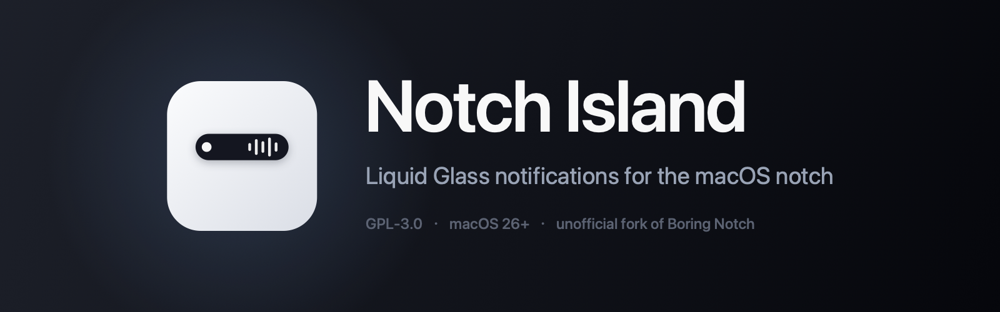
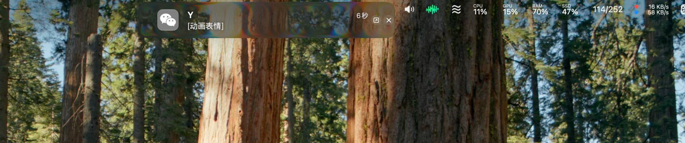
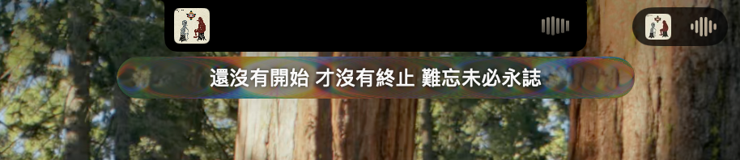

# Notch Island

[](https://github.com/7w4p4qg2xh-ai/notch-island/releases)
[](LICENSE)
[](#环境要求)

<p align="center">
  
</p>

[Boring Notch](https://github.com/TheBoredTeam/boring.notch) 的个人改版：把通知真正搬进刘海、增加蓝牙外设电量、自研液态玻璃材质，并给没有刘海的显示器一个悬浮灵动岛。

> **这是非官方 fork。** 与 The Bored Team 没有任何隶属关系，未获其背书，也不由其提供支持。问题请提到本仓库，不要提到上游。GPLv3 要求的修改声明见 [NOTICE](NOTICE)。

**只提供源码，不提供预编译包。** 对外分发 macOS 应用需要付费开发者账号加公证，本仓库只发代码不发 release。自己编译大约五分钟。

英文说明见 [README.md](README.md)，改动清单见 [CHANGES.md](CHANGES.md)。

---

## 改了什么

两种屏幕，两套独立代码路径，按 `screenUUID` 各自判断。改一边不会动到另一边。

### 内建刘海屏

- **通知被接管，不是镜像。** 系统横幅挪到屏幕外藏起来，改在摄像头开孔下方自己绘制：自动展开、两行卡片、应用图标多路回退解析，点击动作和快捷回复都镜像回岛。板面保持上游围绕开孔调好的 520×132。
- **玻璃歌词条。** 放音乐时，刘海**下方**挂一条 320×26 的胶囊玻璃带显示当前那句——开孔那块屏幕没有像素，字画不进去。
- **展开态的液态玻璃**，参数按苹果材质实测。

### 没有刘海的显示器

- **悬浮灵动岛。** 不再往屏幕顶边贴一块静止黑矩形：收起是 408×66 的卡，展开是 480×150 的面板，圆角随板高走 `Capsule`。
- **收起态也是玻璃**，不是黑底。
- **尺寸可调**：卡片宽度、面板大小、圆角都能在「设置 → 刘海 → 浮岛」里用滑块调，带一键恢复。
- **空闲时整块消失**，全屏下的通知照常弹。

### 两边都有

- **液态玻璃渲染管线**：`CABackdropLayer` → `CASDFLayer` → `CAFilter("glassBackground")`，边缘透镜化、中心留平。
- **感知背后亮度**：用 ScreenCaptureKit 采样板后真实亮度，压着黑窗口时得到带亮边的通透玻璃，而不是一坨看不清的灰。
- **逐行歌词**：LRCLIB 时间轴 → 网易云 → 纯文本。上游先取 AppleScript 纯文本并直接返回，导致带时间轴的路径永远走不到。
- **蓝牙外设电量**：耳机、鼠标、键盘。

哪些地方**故意没抄苹果**（比如字形不随材质翻转、亮背景不自动压 35%），CHANGES.md 里有单独一节说明。

---

## 截图

两张都来自内建刘海屏。

通知卡：系统横幅不再出现，改由灵动岛自己绘制：



音乐卡与当前歌词行，随播放进度推进：



## 环境要求

- macOS 26 (Tahoe) 及以上
- 建议 Apple Silicon，Intel 未测试
- 编译需要 Xcode 26 及以上
- 屏幕录制权限（玻璃采样用）
- 辅助功能权限（抓通知用）

## 自己编译

```bash
git clone https://github.com/<你的用户名>/notch-island.git
cd notch-island
open boringNotch.xcodeproj
```

然后在 Xcode 里：

1. 选中 **boringNotch** target → *Signing & Capabilities* → 选自己的 Team。个人免费 Team 就够，本机运行不需要付费账号。
2. **BoringNotchXPCHelper** target 同样选一次。两个都要签，只签主 app 的话程序能启动但抓不到通知，而且不会报错。
3. 想用自己的标识就改两个 target 的 bundle identifier。XPC 服务名在运行期由它派生，所以主 app 的标识必须等于 helper 标识去掉 `.xpchelper` 后缀。
4. 按 Run。

装到 `/Applications` 更稳：把 DerivedData 里的 `Notch Island.app` 拷过去再启动。程序首次启动会自我迁移包路径，放在固定位置不容易犯迷糊。

### 第一次启动

macOS 不会告诉你缺了什么。来通知了岛上却没反应，按这个顺序查：

1. **系统设置 → 隐私与安全性 → 屏幕录制**：勾上 Notch Island，然后**退出程序重新打开**。权限要重启才生效。
2. **系统设置 → 隐私与安全性 → 辅助功能**：勾上 Notch Island。helper 靠它读横幅文字。**如果列表里找不到 Notch Island，点下方的 `+`，从「应用程序」里手动添加**——macOS 只列出主动请求过该权限的程序，旧版本从来没请求过。
3. **系统设置 → 通知**：先确认发通知的那个应用本身允许通知。

---

## 提示「应用已损坏」

那是你自己签的包，Gatekeeper 找不到 Developer ID，它没判错。要么自己编译（推荐），要么清掉隔离属性：

```bash
xattr -dr com.apple.quarantine "/Applications/Notch Island.app"
```

不要对来路不明的二进制这么干。

## 已知限制

- 只在单台 Apple Silicon 机器、一个内建刘海屏加一个外接屏上验证过。多屏边界情况是最可能出 bug 的地方。
- 玻璃渲染依赖 CoreAnimation 私有符号。未来 macOS 版本可能让它失效，降级结果是变成普通面板，不是崩溃。
- 没有自动更新。本 fork 不发 appcast、不带上游 EdDSA 公钥，安装后不可能被官方版本静默替换。
- 运行中撤销屏幕录制权限，玻璃会降级成「透明底上的白字」。这是有意设计，不是 bug。
- 玻璃保真度靠亮度采样加肉眼确认，没有做逐像素对比。

## 发布成你自己的版本

源码里「关于」窗口、扩展菜单、issue 模板三处留了 `OWNER` 占位符。推到公开仓库前先跑：

```bash
./tools/set-repo.sh 你的GitHub用户名
```

然后重新编译——这些字符串是编进 app 里的，不重编的话界面上还是旧地址。想换配色改
`tools/make-icon.swift` 重新生成图标，它是 Core Graphics 画的，不走图片生成。

## 参与

欢迎 issue 和 PR，但这是个人项目，不承诺支持。改动如果属于上游范畴，请提到 [Boring Notch](https://github.com/TheBoredTeam/boring.notch)——本仓库里歌词源顺序、空闲态抑制这几处上游大概会收。

## 许可

GNU General Public License v3.0，见 [LICENSE](LICENSE) 与 [NOTICE](NOTICE)。

原始作品版权归 The Bored Team 及贡献者所有。
修改部分版权归 2026 Notch Island contributors。

第三方组件声明见 [THIRD_PARTY_LICENSES](THIRD_PARTY_LICENSES)。
